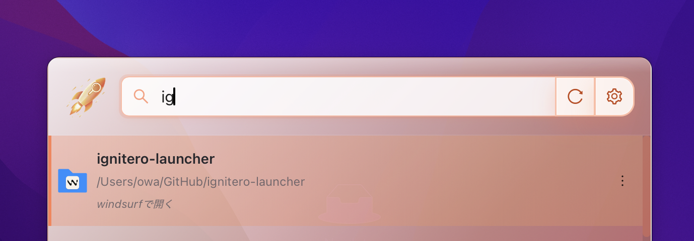
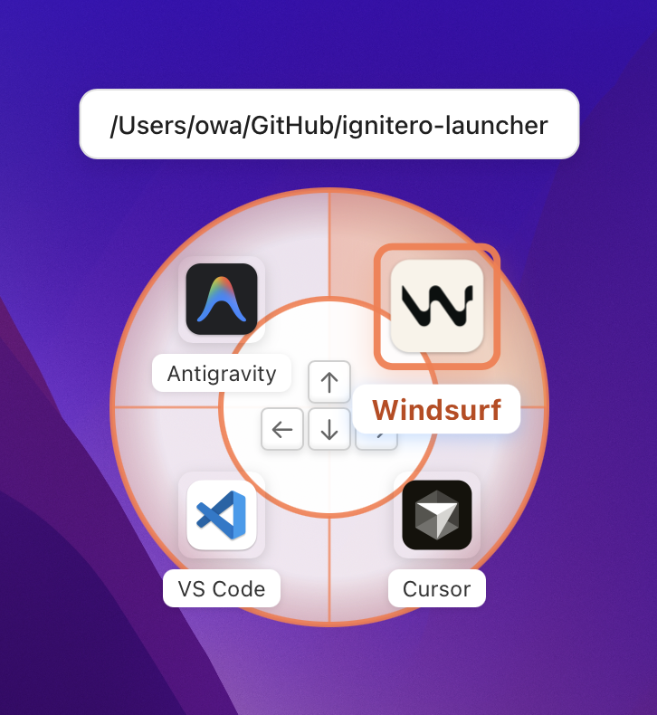
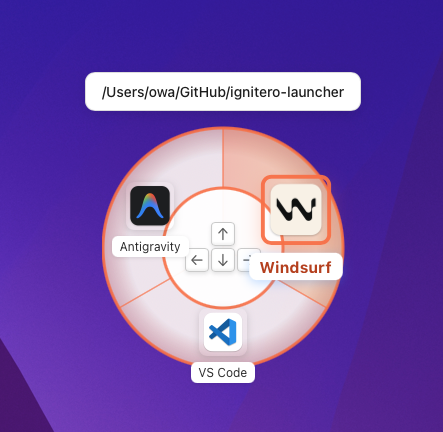
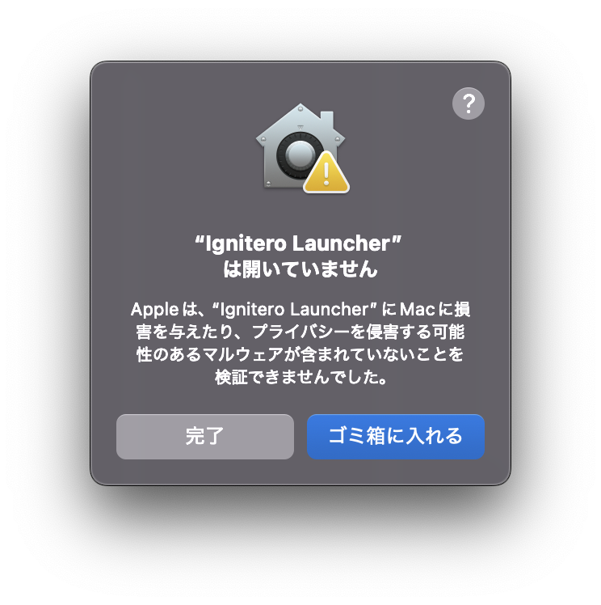
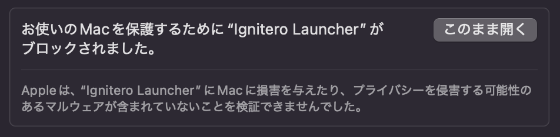
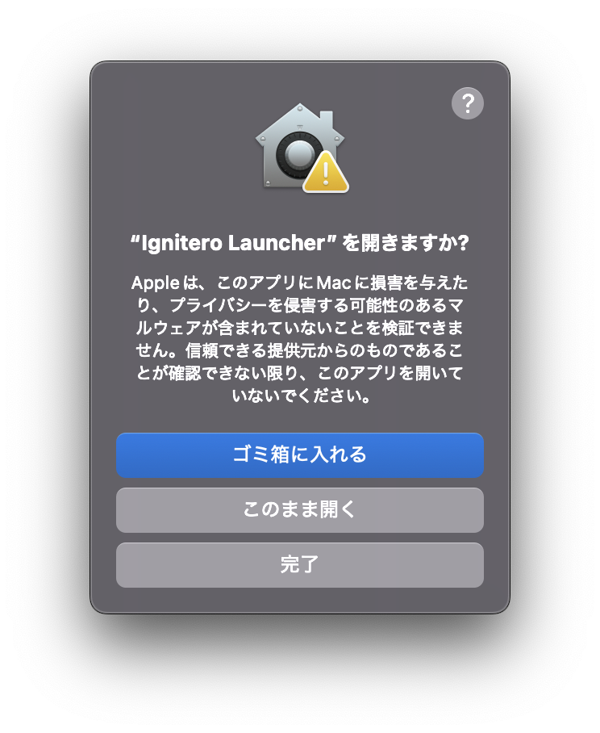

<p align="center">
  
</p>

<h1 align="center">Ignitero Launcher</h1>

<p align="center">
  <a href="https://github.com/owayo/ignitero-launcher/actions/workflows/ci.yml">
    
  </a>
  <a href="https://github.com/owayo/ignitero-launcher/actions/workflows/release.yml">
    
  </a>
  <a href="https://github.com/owayo/ignitero-launcher/releases/latest">
    
  </a>
  <a href="LICENSE">
    
  </a>
</p>

**`Option` + `Space`で即座に呼び出せるメニューバー常駐ランチャー。** Antigravity・Cursor・VS Code・Windsurfをプロジェクトごとに切り替えられ、検索して`Enter`を押すだけで指定エディタが瞬時に立ち上がるから、複数エディタ併用派でも迷子にならない。

`→`キーひとつでターミナルを開き、macOSターミナル/iTerm2/Warp/Ghostty/cmuxからClaude Code・Codex・Gemini CLIなどをすぐ呼び出せるので、相談しながらコードを書く流れが止まらない。プロジェクト切り替えもキーボード操作だけで完結し、現代のマルチツール開発ワークフローを高速化する「手が覚える」ランチャーです。

---

macOS向けの高速アプリケーション・ディレクトリランチャー。Swift 6.2 + SwiftUI + AppKitで構築されたメニューバー常駐型のランチャーです。


## 特徴

- 🚀 **高速検索**: SQLiteキャッシュによる高速なインクリメンタル検索
- 🧮 **計算機能**: 検索欄に計算式を入力すると結果を表示（`Enter`でクリップボードにコピー）
- 🔎 **Web検索アクション**: `g キーワード` で Google、`x キーワード` で X を検索（`&` や `=` を含む検索語も1つのクエリ値として安全にエンコード）
- ⚡ **カスタムコマンド**: よく使うコマンドをエイリアスで登録し、素早く実行
- 🕘 **最近使った項目の再表示**: 空クエリで履歴を表示し、使用回数と最終利用日時で優先度を決定。履歴が上限に達していても新しく選んだ項目を確実に記録
- ⌨️ **自動IME制御**: ウィンドウ表示時に自動的に英字入力モードへ切り替え（TIS APIをメインスレッドで実行して安定化、権限チェックのキャッシュ化により快適な操作）
- 🎯 **アプリケーション起動**: /Applications配下のアプリを素早く起動
- 📁 **柔軟なディレクトリ管理**: ディレクトリ自身や配下のディレクトリをFinder/エディタで開く
- 🔧 **自動検出機能**: インストール済みエディタとターミナルを自動検出し、利用可能なもののみを表示
- 💻 **ターミナル統合**: `→`キーでディレクトリをターミナルで開く
- ✏️ **エディタ選択**: `←`キーで任意のエディタを選んでディレクトリを開く
- 🔑 **グローバルホットキー**: `Option` + `Space`で検索窓を呼び出し
- 🖱️ **ドラッグ移動**: ウィンドウを自由に移動でき、表示のたびに画面中央へ戻す
- 🔄 **自動キャッシュ更新**: 起動時・定期的な自動更新に対応
- ⚙️ **ログイン時起動**: 設定画面から切替可能。状態取得と登録/解除はメインスレッド外で処理し、設定画面の表示を止めない
- 💾 **安全な設定保存**: 書き込みに失敗した場合はメモリ上の設定も変更前へ戻し、未保存の値でアプリが動き続ける不整合を防止。未知のエディタ・ターミナル・表示モードが含まれても該当項目だけを既定値へ戻し、他の設定を保持
- 📌 **メニューバー常駐**: バックグラウンドで常に利用可能
- 🚫 **アプリ除外機能**: 不要なアプリを表示名・バンドル名・パスで検索結果から除外

## 主な機能

### AI利用枠の確認

検索欄で `ai`、`ai usage`、または `利用枠` と入力してEnterを押すと、アカウント別の
使用率・リセット予定・手動リセットを表示します。メニューの「AI利用枠…」からも開けます。
`⌘R`で更新できます。取得に失敗したアカウントは個別にエラーを表示します。

[ai-usage](https://github.com/owayo/ai-usage) の設定・認証・共有キャッシュを使います。
初回にKeychainのアクセス確認が表示される場合があります。

一覧では1アカウントを1行にまとめ、短期枠・長期枠の使用率とリセットまでの時間を横に表示します。
プラン・手動リセットの期限・エラー全文は各行の詳細ボタンから確認できます。

Chromeのアカウントが表示されずmacOSにブロックされた場合は、「ヘルプ」→「アクセス設定…」から
「プライバシーとセキュリティ」→「フルディスクアクセス」を確認してください。
すでに許可済みでも、古い署名の登録が残っている場合は現在のアプリを登録し直し、
ランチャーを完全終了して起動し直す必要があります。

### WebページをMarkdownでコピー

`md https://example.com/article` でページを取得し、Markdownを確認・編集できます。
`md`だけで開いた場合はURLを入力して「取得」を押します。「Markdownをコピー」または
`⌘⇧C`でコピーできます。メニューからも開けます。

[get-md](https://github.com/owayo/get-md) がインストール済みのChrome/Chromiumでページを描画します。
取得用のブラウザは通常のブラウザのログイン状態を引き継がないため、ログインが必要なページは
ログイン画面になる場合があります。本文・URLはランチャーの選択履歴に記録しません。

### 画面の文字を読み取り

検索欄で `ocr` と入力してEnterを押すか、メニューの「画面の文字を読み取り…」を選びます。
読み取りたい範囲をドラッグすると、macOS Visionとocrusが同じ画像を並行して読み取ります。
結果は左右に表示され、先に終わった方から確認・修正・コピーできます。
`⌘1` でVision、`⌘2` でocrusの結果をコピーします。Escで範囲選択や認識を中止します。
初回はmacOSの「画面収録」の許可が必要です。

VisionはmacOS標準の認識機能を使います。OCRusのRustエンジンは静的リンクし、画像をメモリで渡します。モデルはアプリに同梱するため、
認識時の通信・CLIの起動・Pythonのインストールは不要です。認識結果と画像は履歴へ保存せず、
コピー操作を選ぶまでクリップボードを書き換えません。

片方が失敗しても、もう片方の結果は表示したままにします。両方の認識時間も表示します。

開発時はサブモジュールを初期化し、モデルを準備してください。

```bash
git submodule update --init --recursive
make setup-ocr-models
make build-debug  # XCFrameworkも生成する
make test
```

Rustの版はOCRus側の `mise.toml` に従います。`make native` でネイティブライブラリだけを再生成できます。
OCRusを別の作業ツリーで変更する場合は `make native OCRUS_SOURCE_DIR=../ocrus` と指定します。
モデルの配置先を変える場合は `OCRUS_MODEL_DIR` を各makeコマンドへ渡してください。
既存モデルは上書きしません。新規取得では `Resources/ocr-model.lock.json` のリビジョンとSHA-256を確認します。
モデル変換時にはPythonを使いますが、生成済みアプリの実行には不要です。

実モデルを使う追加テストは `IGNITERO_OCR_INTEGRATION=1 swift test --filter OCRNativeTests`、
配布バンドル内のモデルを使う認識の検証は次のコマンドで実行できます。

```bash
.build/IgniteroLauncher.app/Contents/MacOS/IgniteroLauncher --self-test-ocr image.png
```

### 計算機能
- 検索欄に計算式を入力すると、自動的に計算結果を表示
- 対応演算子: `+` `-` `*` `/` `%`（剰余）
- 括弧 `()` による優先順位の指定をサポート
- 128段を超える括弧ネストは無効な式として扱い、極端な入力によるスタックオーバーフローを防止
- 小数点、負数、単項演算子にも対応
- `Enter`キーで計算結果をクリップボードにコピー
- 例: `(100+50)*1.08` → `= 162`

### Web検索アクション
- `g swift concurrency` → Google 検索
- `x swift` → X 検索
- 検索語に `&` / `=` / `+` が含まれても、追加クエリパラメータとして解釈されないよう値としてエンコード

### カスタムコマンド
- よく使うコマンドをエイリアス（短縮名）で登録
- 検索欄にエイリアスを入力して`Enter`でコマンドを実行
- 実行ディレクトリを指定可能（オプション）
- 実行ディレクトリはシェルエスケープして処理（スペースや`'`を含むパスに対応）
- 空クエリでは最近使ったカスタムコマンドも履歴候補として再表示
- カスタムコマンド履歴は `command://UUID` 識別子で管理し、現在登録されているコマンドだけ起動時クリーンアップで保持
- AppleScript実行失敗時はエラーを検出し、Ghostty は `.command` 方式、cmux は CLI 方式へ自動フォールバック
- cmux CLI は実行ファイルの存在と実行権限を確認してから ping し、CLI 起動失敗時や ping 無応答時もアプリ本体がクラッシュ・ハングしないように処理（短命プロセスの終了検出遅延を考慮して 5 秒上限）
- cmux CLI の stdout/stderr は一時ファイルに分けて回収し、大きな stderr 出力でもデッドロックしないように処理。削除処理をファイルハンドル取得前に予約し、stderr 側のハンドル取得失敗時も FD と一時ファイルを残さない
- AppleScript 実行（`osascript`）の stderr Pipe ハンドルは取得直後に `defer` で close し、cmux CLI 経路と同じく FD リークを防止
- `Process` の stdout/stderr 破棄には `FileHandle.nullDevice` を使わず、各プロセス専用の書き込み用 `/dev/null` ハンドルを使って短命 CLI の false negative を防止
- デフォルトターミナル（macOSターミナル / iTerm2 / Warp / Ghostty / cmux）で実行
- Terminal.app は `/System/Applications/Utilities/Terminal.app` を優先し、存在しない環境では従来パスにフォールバック
- 例: `dev` → `pnpm dev`、`build` → `pnpm build`

#### ターミナル自動化方式（2026-10-22確認）

実機の AppleScript 辞書と公式資料を確認した結果です。

| ターミナル | 実機のバージョン | コマンド実行方式 |
|---|---|---|
| Terminal.app | 2.15 | AppleScript の `do script` |
| iTerm2 | 3.7.1 | AppleScript の `create window with default profile` + `write text` |
| Ghostty | 1.3.1 | AppleScript の `new window` + `input text "...\n"`。失敗時は `.command` |
| cmux | 0.65.2 | AppleScript の `new window` + `input text "...\n"`。失敗時は CLI / Socket API |
| Warp | 0.2026.09.16.08.27.02 | AppleScript 辞書がないため `.command` |

[iTerm2 の公式資料](https://iterm2.com/documentation-scripting.html)では AppleScript はメンテナンスモードですが、上記 API は利用できます。[Ghostty は 1.3.0 で対応を導入](https://ghostty.org/docs/features/applescript)しました。1.3 系は preview 扱いのため、1.4 以降へ更新したら辞書を再確認してください。cmux の対応コマンドは[公式の辞書](https://github.com/manaflow-ai/cmux/blob/main/Resources/cmux.sdef)でも確認できます。cmux には `send key` がないため、改行を含めた `input text` で実行を確定します。

Warp は実機の `sdef` がエラー -192 となり、`Info.plist` の `NSAppleScriptEnabled` / `OSAScriptingDefinition` と `.sdef` ファイルもありません。[AppleScript の対応要望](https://github.com/warpdotdev/warp/issues/3364)は未完了です。[URI Scheme](https://docs.warp.dev/terminal/more-features/uri-scheme)は任意のコマンドを実行せず、[制御 CLI の仕様](https://github.com/warpdotdev/warp/blob/master/specs/warp-control-cli/PRODUCT.md)も入力の確定を対象外としているため、既存の `.command` 方式を維持します。

- 作業ディレクトリの `~` は実行時に展開します。移動に失敗した場合、`;`・`||`・改行を含む複合コマンドも全体を実行しません。
- AppleScript へ渡すコマンドと作業パスは、CR（復帰文字）もエスケープして保持します。
- cmux でディレクトリを開く操作は CLI / Socket API を使います。CLI は Homebrew の配置を優先し、解決したアプリの同梱 CLI も探索するため、`~/Applications/cmux.app` でも利用できます。起動後のインストールにも追従します。
- cmux でディレクトリを開く場合は Settings → Automation → Socket Control Mode を「Automation mode」に設定してください。CLI ping は正常終了を確認し、5 秒で打ち切ります。

### アップデート通知
- GitHub Releases（`owayo/ignitero-launcher`）を確認し、新バージョンがあれば起動後に通知
- 複数の安定版リリースが返った場合は、API の配列順ではなくセマンティックバージョン比較で最新を選択
- 結果は12時間キャッシュし、非表示にしたバージョンは再通知しない
- API フェッチ中にユーザーがバナーを「非表示」にした場合も、判定直前に最新の `dismissedVersion` を再取得して反映する

### アプリケーション検索・起動
- `/Applications`、`/System/Applications`、`~/Applications`配下のアプリケーションを自動スキャン
  - システムアプリケーション（/Applications、/System/Applications）
  - ユーザーアプリケーション（~/Applications）
  - Chrome Apps、PWAなども自動検出
- 登録ディレクトリ配下の`.app`ファイルも検索対象に追加可能
  - 除外設定は登録ディレクトリ経由で見つかったアプリにも適用される
  - `~/Applications` のようにアプリスキャン対象と重なるディレクトリを登録しても、アイコン・ローカライズ名・原名を持つアプリスキャン側の情報が優先される
- ファジーマッチングによる柔軟な検索
- **自動IME制御**: ウィンドウ表示時に自動的に英字入力モードへ切り替え
- **アプリ除外機能**: 設定画面から不要なアプリを検索結果から除外可能（表示名・バンドル名・パスの既存設定に対応）

### ディレクトリ管理
- **柔軟な設定**:
  - ディレクトリ自身の開き方を選択（表示しない / Finder / エディタ）
  - 配下のディレクトリの開き方を選択（表示しない / Finder / エディタ）
  - ディレクトリごとに異なるエディタを設定可能
  - 親ディレクトリにカスタム検索キーワードを設定可能
  - 末尾スラッシュ付きパスやルートディレクトリ`/`も正規化して扱う
- **エディタ自動検出**: インストール済みエディタを自動検出
  - 対応エディタ: Antigravity、Cursor、VS Code、Windsurf、Zed
  - `/Applications`と`~/Applications`の両方をチェック
  - インストール済みのエディタのみが選択肢に表示される
- **エディタ選択ランチャー**: ディレクトリ選択時に`←`キーでエディタを選択
  - インストール済みエディタから選んで開く
  - 設定されたデフォルトエディタを上書きできる
  - **頭文字キーで即座に起動**: `W`(Windsurf)、`C`(Cursor)、`V`(VS Code)、`A`(Antigravity)、`Z`(Zed)
  - 対応エディタ: Antigravity、Cursor、VS Code、Windsurf、Zed
- **ターミナル統合**: ディレクトリ選択時に`→`キーでターミナルを開く
  - 対応ターミナル: macOSターミナル（常に利用可能）、iTerm2、Warp、Ghostty、cmux
  - インストール済みのターミナルのみが選択肢に表示される

### キャッシュ管理
- SQLiteによる高速なキャッシュ
- キャッシュ保存・読み込みは `CacheDatabaseProtocol` 経由で統一し、テスト用モックや将来の別実装でも AppCoordinator が同じ経路で ViewModel へ反映
- アプリと登録ディレクトリのファイル走査は `@concurrent` でメインアクター外へ移し、起動時・自動更新・手動再構築中も UI 操作を阻害しない
- 更新タイミングを細かく設定可能：
  - 起動時に更新
  - 自動更新（1〜24時間間隔で設定可能）
  - 手動更新（ステータスバーまたは設定画面から）
- ステータスバーの「キャッシュを再構築」もスキャン結果を確実に DB へ保存し、ビューモデルへ再読込
- ランチャー表示中にキャッシュやコマンド設定が更新されたら、入力中のクエリで検索結果も再計算。空クエリの履歴表示にも反映し、削除済みの項目や編集前のコマンドが残るのを防止
- 更新後も同じ項目があれば選択を引き継ぎ、自動更新による選択位置のリセットを防止
- アイコンキャッシュは自動更新と手動再構築が並行しても破損しないよう原子的書き込み（`Data.write(options: .atomic)`）で保護

### UI/UX
- シンプルで直感的な検索インターフェース
- **キーボードナビゲーション**:
  - `↑` `↓`キーで項目選択（選択項目を自動スクロール）
  - `Enter`で起動（計算結果表示時はクリップボードにコピー）
  - `→`キーでディレクトリをターミナルで開く
  - `←`キーでディレクトリのエディタを選択
  - `Escape`で閉じる
- `Option` + `Space`で即座にアクセス
- **ドラッグ移動**: ウィンドウをドラッグして好きな位置に移動可能（次回表示時は画面中央へ戻る）
- macOS標準のぼかし効果（window-vibrancy）
- ツールチップ付きアイコンボタン（キャッシュ更新・設定）

## スクリーンショット

### 検索してディレクトリを選択



検索結果からディレクトリを選んで`Enter`で開くことができます。ファジーマッチングによる柔軟な検索が可能です。

### エディタ選択ランチャー



インストールされているエディタのみ表示されます。



ディレクトリを選択して`←`キーを押すと、エディタ選択ランチャーが表示されます。インストール済みのエディタ（Antigravity、Cursor、VS Code、Windsurf）から選んで開くことができます。

**キーボードショートカット**:
- `W`: Windsurf で開く
- `C`: Cursor で開く
- `V`: VS Code で開く
- `A`: Antigravity で開く
- `Z`: Zed で開く
- `↑` `↓` `←` `→`: エディタを選択
- `Enter`: 選択したエディタで開く
- `Escape`: キャンセル

## 必要要件

- macOS 26以降
- Swift 6.2以降
- Xcode 26以降
- [mise](https://mise.jdx.dev)（`make build` / `make bundle` / `make install` が絵文字キーワード辞書の生成に使う Python の版を `mise.toml` で固定している。mise を使わない場合は `SYSTEM_TOOLS=1` を付けると PATH の `python3` を使う）

## インストール

### 開発環境での実行

```bash
# リポジトリをクローン
git clone --recurse-submodules https://github.com/owayo/ignitero-launcher.git
cd ignitero-launcher
make setup-ocr-models

# デバッグビルド＆直接実行
make dev
```

### プロダクションビルド

```bash
# リリースビルド
make build

# .appバンドル作成
make bundle
```

`make build` は Swift 6.3.2 の release optimizer が KeyboardShortcuts 3.0.0 のビルド中にクラッシュする環境を避けるため、Swift 最適化を無効化して release 出力を生成します。

### アプリケーションのインストール

```bash
# /Applications にインストール＆起動
make install
```

#### macOSのセキュリティ設定について

このアプリはApple Developer Programによる署名・公証を行っていないため、初回起動時にmacOSのGatekeeperによってブロックされます。以下のいずれかの方法で許可してください。

##### 方法1: ターミナルから隔離属性を削除（推奨）

```bash
xattr -d com.apple.quarantine "/Applications/Ignitero Launcher.app"
```

このコマンドを実行後、アプリを通常通り起動できます。

##### 方法2: システム設定から許可

1. アプリをダブルクリックで起動しようとすると警告が表示されます
2. **「完了」** をクリック
   
3. **「システム設定」** → **「プライバシーとセキュリティ」** を開く
4. 下にスクロールし、「お使いのMacを保護するために"Ignitero Launcher"がブロックされました」というメッセージを探す
5. その横にある **「このまま開く」** ボタンをクリック
   
6. 確認ダイアログが表示されたら **「このまま開く」** をクリック
   

> **なぜこの手順が必要なのか？**
> Apple Developer Program に加入し、アプリに正式な署名と公証を行うと、この手順は不要になりますが個人開発のため署名を行っていません。

### 必要な権限

このアプリケーションを快適に使用するために、以下の権限が必要です。

#### アクセシビリティ権限（必須）
**用途**: ウィンドウ表示時に自動的に英字入力モードへ切り替えるために必要

**設定方法**:
1. **システム設定** → **プライバシーとセキュリティ** → **アクセシビリティ**
2. 左下の🔒をクリックして認証
3. **「+」** ボタンをクリック
4. **Ignitero Launcher** を選択して追加
5. チェックボックスを有効化
6. アプリを再起動

> 初回起動時に権限要求ダイアログが表示される場合があります。「システム設定を開く」をクリックして上記の手順で設定してください。
>
> **パフォーマンス最適化**: 権限チェックはキャッシュされるため、2回目以降は繰り返しプロンプトが表示されず快適に使用できます。

#### フルディスクアクセス権限（オプション）
**用途**: リムーバブルディスクや外部ストレージ上のディレクトリを検索・起動する場合に必要

**設定方法**:
1. **システム設定** → **プライバシーとセキュリティ** → **フルディスクアクセス**
2. 左下の🔒をクリックして認証
3. **「+」** ボタンをクリック
4. **Ignitero Launcher** を選択して追加
5. チェックボックスを有効化
6. アプリを再起動

> 通常のアプリケーション起動やローカルディレクトリの検索には不要です。外部ストレージを使用する場合のみ設定してください。

## 使い方

### 基本操作

1. `Option` + `Space`で検索窓を表示
2. アプリ名、ディレクトリ名、またはコマンドエイリアスを入力
3. `↑` `↓`キーで選択
4. ディレクトリの場合:
   - `Enter`で設定されたエディタまたはFinderで開く
   - `→`キーでターミナルで開く
   - `←`キーでエディタを選択して開く（`W` `C` `V` `A` `Z`で即座に起動）
5. アプリケーションの場合:
   - `Enter`で起動
6. コマンドの場合:
   - `Enter`でデフォルトターミナルで実行
7. `Escape`でウィンドウを閉じる

### 設定

設定は以下の方法でアクセスできます：
- 検索窓右上の⚙️アイコンをクリック
- メニューバーアイコン → 「設定」

設定画面は4つのタブで構成されています：
- **全般**: デフォルトターミナル、キャッシュ更新設定
- **ディレクトリ**: 検索対象ディレクトリの登録・管理
- **コマンド**: カスタムコマンドの登録・管理
- **除外アプリ**: 検索結果から除外するアプリの管理

#### ディレクトリの登録

1. 設定画面を開く
2. 「ディレクトリを追加」をクリック
3. フォルダを選択
4. **このディレクトリ自身**の設定:
   - 検索に表示しない / Finderで開く / エディタで開く を選択
   - エディタで開く場合、インストール済みエディタから選択（Antigravity/Cursor/VS Code/Windsurf/Zed）
   - カスタム検索キーワードを設定可能（例: `~/GitHub` → "git"で検索）
5. **配下のディレクトリ**の設定:
   - 検索に表示しない / Finderで開く / エディタで開く を選択
   - エディタで開く場合、インストール済みエディタから選択（Antigravity/Cursor/VS Code/Windsurf/Zed）
6. 「アプリスキャン」を有効にすると、そのディレクトリ配下の`.app`ファイルも検索対象に

> **エディタ自動検出**: `/Applications`と`~/Applications`の両方をチェックし、インストール済みのエディタのみが選択肢に表示されます。エディタをインストール後は設定画面を開き直すことで自動的に選択肢に追加されます。

#### カスタムコマンドの登録

1. 設定画面の「コマンド」タブを開く
2. 「コマンドを追加」をクリック
3. 以下の項目を設定:
   - **エイリアス**: 検索時に使用する短縮名（例: `dev`、`build`）
   - **コマンド**: 実行するコマンド（例: `pnpm dev`、`npm run build`）
   - **実行ディレクトリ**（オプション）: コマンドを実行するディレクトリを指定
4. 「追加」をクリック

> 登録したコマンドは検索欄にエイリアスを入力して`Enter`で実行できます。コマンドはデフォルトターミナルで実行されます。

#### デフォルトターミナルの設定

検索結果でディレクトリを選択して`→`キーを押したときに開くターミナルを選択できます。**インストール済みのターミナルのみが選択肢に表示されます**:
- macOSデフォルトターミナル（常に利用可能）
- iTerm2（インストール済みの場合）
- Warp（インストール済みの場合）
- Ghostty（インストール済みの場合）
- cmux（インストール済みの場合）

> **cmux を使用する場合**: ディレクトリを cmux で開く機能は CLI / Socket API を使うため、Settings → Automation → Socket Control Mode を「Automation mode」に設定してください。カスタムコマンド実行は AppleScript を優先し、失敗時のみ CLI へフォールバックします。

#### キャッシュ更新設定

- **起動時に更新**: アプリ起動時にキャッシュを再構築
- **自動更新**: 指定時間間隔で自動的にキャッシュを更新
- **手動更新**: 「今すぐキャッシュを更新」ボタンまたはメニューバーメニューから

#### アプリ除外設定

不要なアプリを検索結果から除外できます：

1. 設定画面の「除外アプリ」タブを開く
2. 除外したいアプリの行をクリック（またはチェックボックスをクリック）
3. チェックを付けたアプリは検索結果に表示されなくなります
4. 上部の検索欄でアプリ名を絞り込み可能

> 除外したアプリは赤い背景と取り消し線で表示されます。再度クリックすることで除外を解除できます。

## 技術スタック

- **言語**: Swift 6.2 (Strict Concurrency)
- **UI**: SwiftUI + AppKit (NSPanel)
- **データ**: GRDB.swift (SQLite), JSON 永続化
- **検索**: Fuse-Swift（ファジー検索）
- **ショートカット**: KeyboardShortcuts (`Option` + `Space`)
- **テスト**: Swift Testing
- **パッケージ**: Swift Package Manager
- **最小OS**: macOS 26

## 設定ファイル

設定は以下の場所に保存されます：
- 設定ファイル: `~/.config/ignitero-launcher/settings.json`
- キャッシュDB: `~/.config/ignitero-launcher/cache.db`
- アイコンキャッシュ: `~/.cache/ignitero/icons/`

将来バージョンの設定ファイルに未知のエディタ・ターミナル・ディレクトリ表示モードが含まれる場合、そのフィールドだけを安全な既定値へ戻して読み込みます。登録ディレクトリ、カスタムコマンド、除外アプリなど他の設定は破棄しません。

設定の I/O 読み込み、または選択履歴の I/O・デコードが失敗した場合は、その起動中の保存を拒否します。起動を継続した後の終了処理がデフォルト設定や空履歴で既存ファイルを上書きするのを防ぎ、外部でファイルを復旧して再読み込みに成功した場合だけ保存を再開します。

## ショートカット

| キー | 動作 |
|------|------|
| `Option` + `Space` | 検索窓の表示/非表示 |
| `↑` `↓` | 検索結果の選択 |
| `Enter` | 選択項目を起動 / コマンド実行 / 計算結果をクリップボードにコピー |
| `→` | ディレクトリをターミナルで開く |
| `←` | ディレクトリのエディタを選択 |
| `Escape` | ウィンドウを閉じる |

## トラブルシューティング

### アプリが検索に表示されない
1. 設定画面から「今すぐキャッシュを更新」を実行
2. メニューバー → 「キャッシュを再構築」を選択

### ホットキーが動作しない
- 他のアプリが同じキーボードショートカットを使用していないか確認
- システム環境設定 → キーボード → ショートカットを確認

### エディタが起動しない
- エディタがアプリケーションとしてインストールされているか確認
  - Antigravity.app
  - Cursor.app
  - Visual Studio Code.app
  - Windsurf.app
  - Zed.app
- アプリケーションが `/Applications` に存在するか確認

## 開発

```bash
# デバッグビルド＆直接実行
make dev

# デバッグビルド
make build-debug

# リリースビルド
make build

# テスト実行
make test

# .appバンドル作成
make bundle

# /Applicationsにインストール＆起動
make install

# ログストリーム
make log

# ビルドキャッシュ削除
make clean
```

ツールの版は `mise.toml` が正です（Python のみ。Swift は Xcode のツールチェーンを使います）。Makefile は Python を `mise exec --` 経由で呼ぶため、シェルで `mise activate` していなくても固定した版で動きます。mise が見つからない場合は Python を使うターゲットが停止するので、PATH のツールを使うときは `make build SYSTEM_TOOLS=1` のように明示してください。CI も `jdx/mise-action` で同じ `mise.toml` と `mise.lock`（取得元 URL と checksum）を使います。

### 検索性能の比較

履歴による検索順位の調整は、クエリごとに完全一致・前方一致の履歴をパス別に照合します。
同じ一致種別では最初の履歴を使い、完全一致を優先します。空クエリの履歴表示では使用回数と日時による順位を保ちます。
履歴JSONの使用回数が負でも、古い履歴を整理する際の比較が壊れないようにしています。

```bash
# 通常のテストではスキップする比較用ベンチマーク
IGNITERO_SEARCH_BENCHMARK=1 swift test --filter SearchBenchmarkTests

# 同じビルドのまま、別プロセスで繰り返す
IGNITERO_SEARCH_BENCHMARK=1 swift test --skip-build --filter SearchBenchmarkTests
```

ベンチマークは20・500・2,000アプリと履歴50件を使い、各ケースを5回ウォームアップして7標本を記録します。
時間の合否判定は行いません。ビルド条件をそろえ、別プロセスを3回起動してCPU時間・経過時間・最大RSSを比較してください。
[2026-10-31の点検記録](docs/maintenance-2026-10-31.md)に、測定条件・生データ・採用しなかった変更も記載しています。

## ライセンス

MIT License

## 貢献

Issue、Pull Requestを歓迎します。
