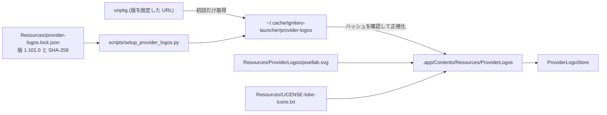

# AI利用枠のブランドアイコンと色分け

AI利用枠の一覧に、プロバイダのブランドアイコンを表示した。使用率・リセットまでの残り時間・
手動リセットの期限は、ai-usage と同じ基準で色分けする。判定の規則は ai-usage と一致させ、
色の値だけを macOS の外観 (ライト・ダーク・コントラストを上げる設定) に合わせた。
ブランドの SVG はリポジトリに入れず、版と SHA-256 を確かめてから `.app` に同梱する。

## 色分けの規則

判定は `Sources/IgniteroCore/UI/AIUsageStyle.swift` に置いた。ai-usage の `render/palette.rs`・
`render/reset.rs`・`render/manual_resets.rs` と同じ境界値を、`AIUsageStyleTests` で固定している。

- 使用率: 60%未満は緑、80%未満は黄、90%未満は橙、それ以上は赤。60・80・90% ちょうどは上の段階に入る。
  80%以上は数字を太字にし、色以外でも目立たせる。不明な使用率は「不明」と表示し、バーを点灯しない。
- リセットまでの残り時間: 周期ごとのしきい値 (5時間は1・2・3時間、1日は4・8・12時間、
  1週間は1・2・4日、1か月は3・7・14日) の未満で赤・橙・黄になる。境界ちょうどは余裕のある側に入る。
  期限を過ぎた枠は緑、時刻が不明な枠は灰色。
- 周期の補完: `kind` を持たない旧キャッシュは、短期枠を5時間、長期枠をPixelLabとGrokは月次、
  それ以外は週次として扱う。未知の `kind` は周期を推測せず、残り時間の色を灰色にする。
- 手動リセット: 種類ごとに残回数を合算し、期限を過ぎた付与分は数えない。一覧には利用できる付与分の
  最も近い期限を出し、残り7日未満なら日付を赤にする。従来は付与分ごとに1行ずつ表示していたため、
  同じ種類が複数の行に分かれていた。詳細には付与分ごとの期限を並べる。
- 取得失敗: 赤 (ai-usage の ALERT と同じ)。

残り時間は ai-usage と同じく切り捨てで数え、1日以上は「あと3日23時間」のように日数で表す。
色は丸める前の秒数で決めるため、週次の「あと3日23時間」は黄、ちょうど4日から緑になり、
表記としきい値が食い違わない。1分未満は「あと1分未満」とし、期限前の枠を「0分」にしない。

一覧は親の `TimelineView` が渡す1つの時刻で、全行の残り時間と色を計算する。行ごとに時計を持つと、
しきい値の境界で行によって判定が食い違う。ai-usage の TUI も、1回の描画で時刻を1度だけ取る。

## 色の値

色の値は `AIUsageColors.swift` が外観ごとに持つ。ダークは ai-usage の端末色 (xterm 256色の35・178・208)
を使い、赤だけを196 (#FF0000) から #FF4D4D に明るくした。196はダークの背景に対して4.17:1で、
文字に求める4.5:1に届かない。ライトでは端末色が白い背景に対して2.1〜4.0:1しかなく読めないため、
同じ色相のまま暗くした。

| 段階 | ダーク | ライト | ダーク (コントラストを上げる) | ライト (コントラストを上げる) |
|------|--------|--------|------------------------------|------------------------------|
| 緑 | #00AF5F (5.79:1) | #007A45 (5.43:1) | #62E6A1 (10.60:1) | #004C2A (10.16:1) |
| 黄 | #D7AF00 (7.96:1) | #856300 (5.55:1) | #FFE080 (12.88:1) | #4D3B00 (10.82:1) |
| 橙 | #FF8700 (6.92:1) | #A84A00 (5.76:1) | #FFB36B (9.46:1) | #6B2D00 (10.50:1) |
| 赤 | #FF4D4D (5.10:1) | #C8102E (5.88:1) | #FF9D98 (8.36:1) | #7D1610 (10.53:1) |

比は macOS 27 のウィンドウ背景 (ライト #FFFFFF、ダーク #1E1E1E) に対する値。
`AIUsageStyleTests` が、実行環境の `windowBackgroundColor` を外観ごとに解決し、文字の色が4.5:1以上、
ブランドアイコンの色が3:1以上であることを検査する。色を変えたら、このテストが通ることを確かめる。
コントラストを上げる設定 (`colorSchemeContrast == .increased`) は、ウィンドウの外観を変えても
切り替わらないため、画面の撮影ではなくこの検査で確かめている。

ラベルと補助の文字 (ai-usage の LABEL・MUTED) は、OS の `.secondary` を使う。バーの未点灯部は `.quaternary`。

## ブランドアイコン

アイコンは ai-status-font と同じ SVG を使う。対応は ai-usage の statusline の `--logos` と同じで、
CodexにはOpenAIのマークを使う。

| プロバイダ | SVG | 取得元 |
|-----------|-----|--------|
| Claude | `claude.svg` | lobe-icons |
| Codex | `openai.svg` | lobe-icons |
| Antigravity | `antigravity.svg` | lobe-icons |
| Grok | `grok.svg` | lobe-icons |
| PixelLab | `pixellab.svg` | 自作 (`Resources/ProviderLogos/` にコミット) |

アイコンの色は ai-usage の marker の色に合わせた。Claudeは #D97757、Antigravityは #4285F4、
PixelLabは #84CC16。白黒のブランドであるCodexとGrokは、端末の白に当たる前景色 (`.primary`) にする。
PixelLabの黄緑は白い背景に対して1.98:1しかないため、ライトでは同系の #4D7C0F (4.99:1) にした。
コントラストを上げる設定では、形と名前で見分けられるため、すべて前景色にする。
provider名の文字は着色しない。使用率の警告色とブランド色が並ぶと、どちらの意味の色か紛らわしいため。

### 取得と同梱

lobe-icons (`@lobehub/icons-static-svg`、MIT) のSVGはコミットしない。ai-status-font と同じく、
リポジトリには取得元・版・SHA-256だけを置く。OCRモデル (`Resources/ocr-model.lock.json`) と同じ方式。



`make bundle` と `make dev` が、署名の前にスクリプトでSVGを `.app` へ置く。取得したSVGは
キャッシュに残り、ハッシュが一致すれば2回目以降はネットワークに接続しない。
`make setup-provider-logos` はキャッシュの用意だけを行う。CIとリリースでも同じスクリプトを使い、
欠落・ハッシュの不一致・ライセンスの欠落はエラーにする。

正規化では、`width`・`height` を `viewBox` と同じ数値にし、塗りを黒に固定する。パスの `d` は変えない。
lobe-icons のSVGは `width="1em"` のため、そのままでは `NSImage` の大きさが1×1ptになる。
許可する要素は `svg`・`title`・`path` だけで、それ以外を含むSVGは版を上げたときに検出して止める。

### 実行時

SVGは SwiftPM のリソースではないので、`Bundle.module` も `ResourceBundle` も通らない。
`ProviderLogoStore` が `Bundle.main.resourceURL/ProviderLogos` から読み、テンプレート画像として
SwiftUI で着色する。読めないプロバイダはアイコンを出さず、provider名の文字だけで表示する。
読み込みの結果は成功・失敗とも記憶し、失敗はプロバイダごとに1度だけ warning を残す (`make log`)。

`make verify-bundle` は6ファイル (SVG 5つとライセンス) の有無を、`--self-test-resources`
(`make smoke-resources`) は全アイコンを実際に描いて不透明な画素が5%以上あることを確かめる。

## 画面の確認

次のコマンドで、ライトとダークの画面をPNGに書き出せる。通常のテストでは実行しない。

```bash
make bundle
IGNITERO_AI_USAGE_SNAPSHOT_DIR=/tmp/ai-usage-snapshots \
IGNITERO_PROVIDER_LOGO_DIR=.build/IgniteroLauncher.app/Contents/Resources/ProviderLogos \
  swift test --filter AIUsageSnapshotTests
```

全プロバイダ、色の4段階、不明な使用率、取得失敗、7日未満の手動リセットの期限を1画面に並べる。

## 設計の相談

色の写像と SVG の持ち込み方は、codex (GPT-6.1-Sol) に相談して決めた。次の点は提案どおり。

- SVGは版を固定して取得し、検証してから同梱する。コミットしない
- 判定の規則と色の値を分け、規則だけを ai-usage と一致させる
- 1日以上の残り時間は日数で表し、色は丸める前の秒数で決める
- 手動リセットの最も近い期限を一覧にも出す
- 未知の `kind` は周期を推測しない
- 一覧の全行を1つの時刻で計算する

提案から変えた点もある。提案されたライトの黄 (#705600) は茶色に寄って橙と区別しにくかったため、
4.5:1以上を保ったまま明るい #856300 にした。ダークの赤は、提案の #FF5F56 より端末の赤に近い
#FF4D4D にした。期限を過ぎた枠の表記は、既存の「リセット待ち」を残した。
